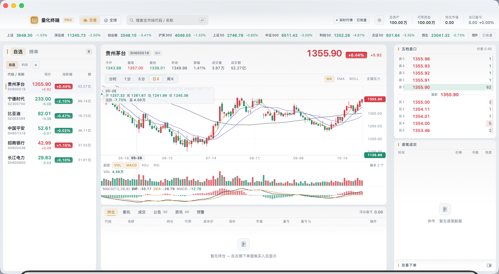
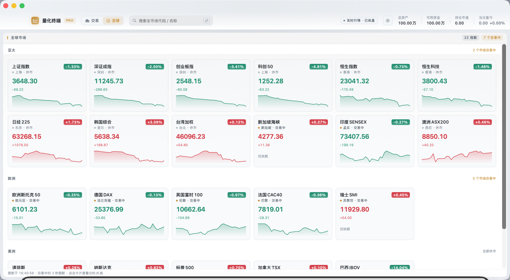

# 量化终端（StockTerminal）

[](https://developer.apple.com/macos/)
[](https://swift.org)
[](https://developer.apple.com/xcode/swiftui/)
[](./LICENSE)

**Mac-native A-share watchlist & charting terminal** with local simulated trading — SwiftUI, candlestick (K-line), order book, and public market data (no API keys).

macOS 原生「看盘 + 本地模拟交易」专业终端。自选 / 榜单 / K 线 / 分时 / 五档逐笔，真实行情驱动本地撮合。

| | |
|---|---|
| **平台** | macOS 15+ · Swift 6 · SwiftUI |
| **行情** | 腾讯 + 东方财富公开接口（免密钥）；离线自动 Mock |
| **交易** | 本地模拟撮合（费用、T+1、持仓/委托/成交） |
| **关键词** | A股 · 看盘 · K线 · 分时 · 自选股 · 涨跌幅榜 · 龙虎榜 · trading terminal |

---

## 功能亮点

- **自选板块**：多板块、表头排序、搜索全 A（沪/深/北）加入自选
- **市场榜单**：涨幅 / 跌幅 / 成交额 / 换手 / 振幅 / 涨停 / 跌停 / 龙虎榜（与自选同款列表交互）
- **中栏图表**：分时 · 1/5 分 · 日/周 K；MA / EMA / BOLL；VOL · MACD · KDJ · RSI；可选支撑压力
- **触控板**：捏合缩放时间轴、两指左右平移历史 K（上下不缩放）
- **盘口**：五档深度 + 逐笔；图表头资金流摘要
- **指数条**：上证 / 深成 / 创业板 / 沪深300 等 + 港美主要指数
- **全球视图**：只读指数卡片与详情 K 线
- **预警**：价格 / 涨跌幅条件 + 系统通知
- **加自选**：个股详情未在自选时一键加入

## 界面预览

<p align="center">
  
  &nbsp;
  
</p>

<p align="center">
  <sub>
    <b>左 · 交易 / 自选 + 日K</b> — Watchlist, candlestick, order book<br/>
    <b>右 · 全球</b> — Asia / Europe / Americas index cards
  </sub>
</p>

## 快速开始

**要求：** macOS 15+，Xcode 16+ / Swift 6 工具链。

```bash
git clone https://github.com/skysh3n/StockTerminal.git
cd StockTerminal
swift run StockTerminal          # 开发模式
```

打包并安装到「应用程序」（中文名 **量化终端**，ad-hoc 签名）：

```bash
./Scripts/build-app.sh && open /Applications/量化终端.app
```

用 Xcode：打开 `StockTerminal.xcodeproj`，选 scheme「量化终端」，⌘R。同一 scheme 下 ⌘U 跑单测。

```bash
swift test
swift run tokens-export > tokens.json   # 设计 tokens 导出（已 gitignore）
```

## 数据源

| 数据 | 来源 | 频率 |
|---|---|---|
| 全市场搜索 | 东财 `searchapi` | 防抖 250ms |
| 快照 + 五档 | 腾讯 `qt.gtimg.cn` | 盘中 ~3s |
| 日/周/1分/5分 K | 腾讯 `ifzq.gtimg.cn` | 盘中 ~5s 增量 |
| 逐笔 | 东财 `push2his` | 盘中 ~3s |
| 榜单 / 龙虎榜 | 东财 clist / datacenter / 选股兜底 | 按需 |

顶部徽章显示「实时行情」或「模拟数据」。真实行情下本地撮合由真实报价驱动；接口不可用时整体回退 Mock。

> **免责声明：** 公开行情仅供学习与研究，不构成投资建议；模拟交易非实盘。

## 架构

```
Sources/
├── TradingCore/       # 纯逻辑：模型、指标、撮合、腾讯/东财行情（无 SwiftUI）
├── DesignSystem/      # 平台无关 design tokens → tokens.json
└── StockTerminalApp/  # macOS SwiftUI：三栏终端、stores、图表
```

跨平台预留：`MarketDataService` / `TradingService` / `AccountService` 协议边界；指标库为纯函数，可移植。

## 路线图

- [ ] 真实券商柜台（协议已预留）
- [ ] iOS 版
- [ ] 更多画线与条件单
- [ ] Windows / Linux 原生 UI

## 贡献与许可

见 [CONTRIBUTING.md](./CONTRIBUTING.md)。许可证：[MIT](./LICENSE)。

---

**English:** StockTerminal（量化终端）is an open-source **macOS SwiftUI trading terminal** for **A-share** watchlists, **candlestick / K-line** charts, market boards, and **local paper trading** driven by public quote APIs (Tencent + Eastmoney). No API keys required. Build with Swift 6 / Xcode, or `./Scripts/build-app.sh` to install `量化终端.app`.
